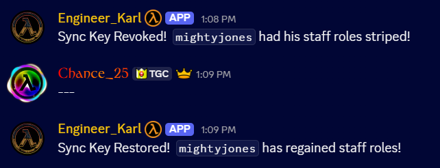
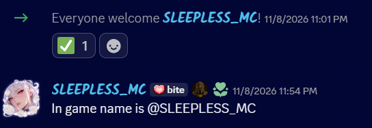
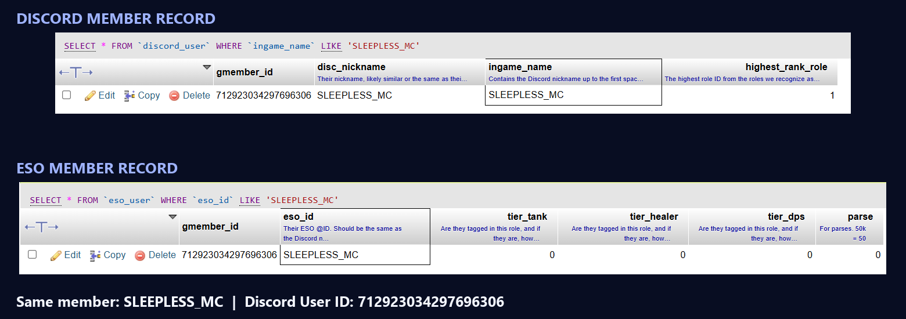
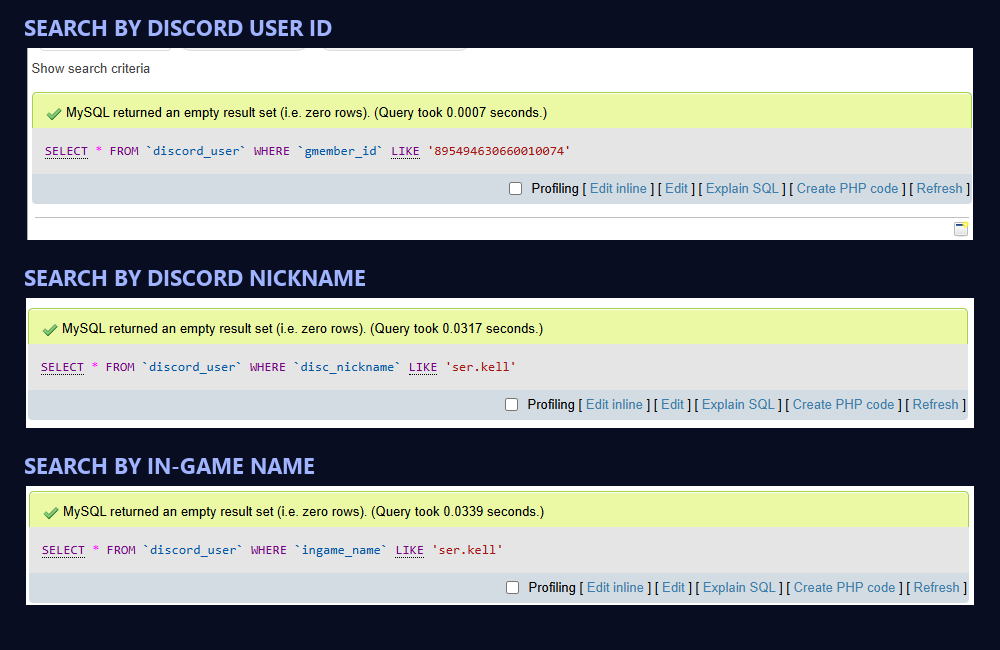

# Guild Members — Engineer Karl demos

## 1. Access management

Guild Members intent provides the role-change events Karl needs to update access on TGC's linked platforms.

## 2. Join/leave logging

Guild Members intent provides the join and departure events Karl needs to generate these logs.

## Additional info

Joining provisions a basic account for TGC's linked platforms.

Leaving revokes access and deletes the provisioned account.

