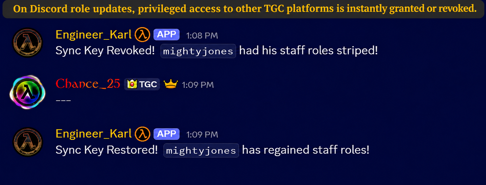
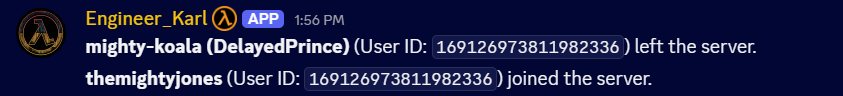

# Guild Members — Engineer Karl demos

## 1. Access management

Discord role changes update access on TGC's linked platforms.

## 2. Join/leave logging and platform accounts

Karl logs when members join or leave Discord.

Joining provisions a basic account for TGC's linked platforms.

Leaving revokes access and deletes the provisioned account.

