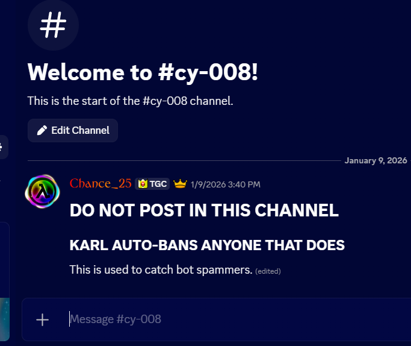
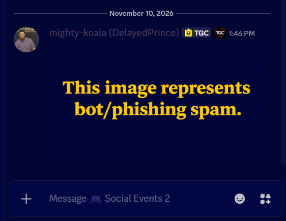
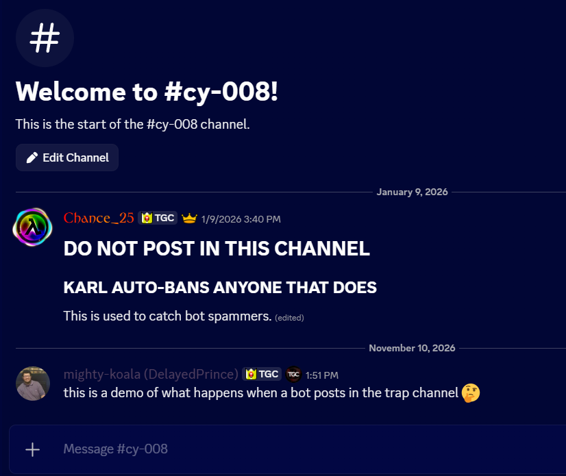
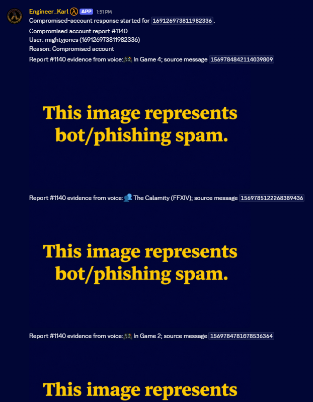
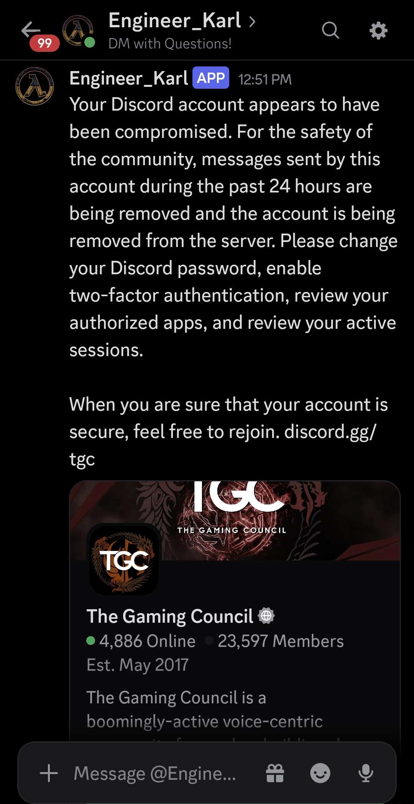

# 1. Compromised-account response

1. A trap channel for bots.

2. A user's account gets compromised and sprays phishing links everywhere.

3. A user posts in the trap channel, screenshotted seconds before being removed.

**4. Message Content intent provides the text/attachments that Karl forwards to another channel, preserving evidence.**

5. Karl extends a server invite with a security-oriented message to the compromised user.

