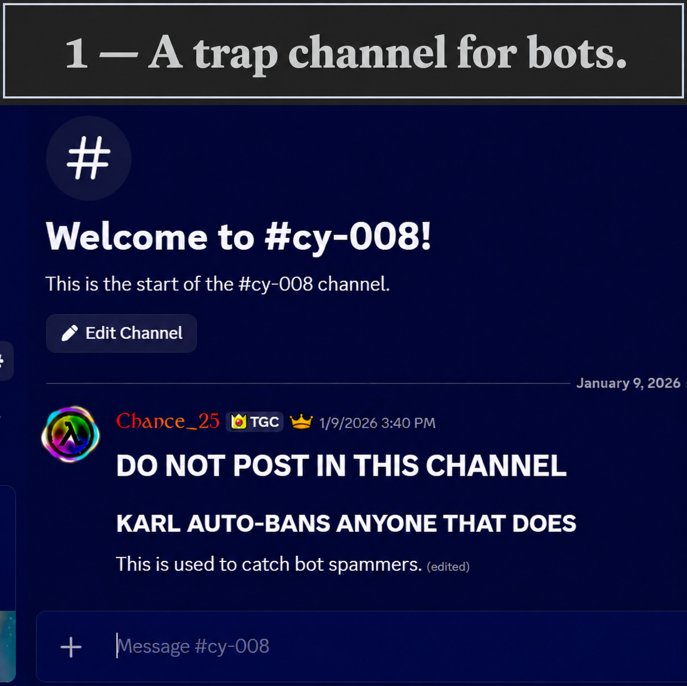
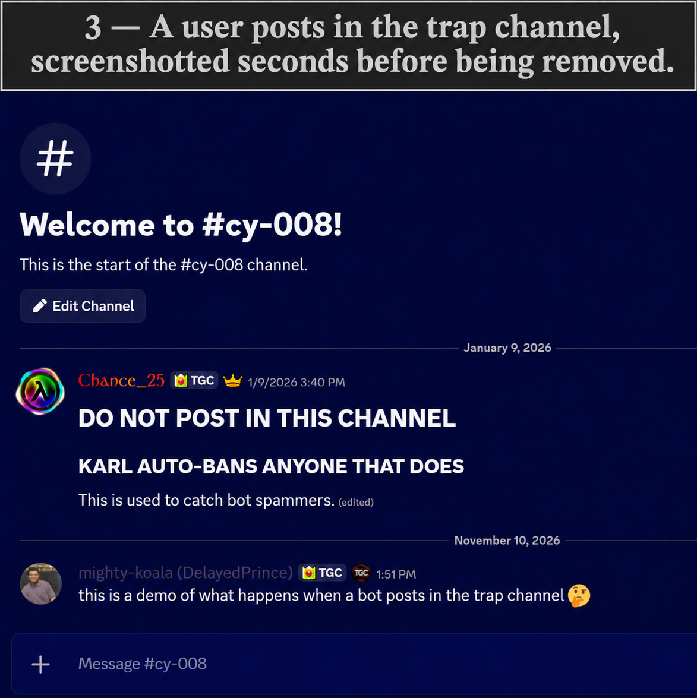

# 1. Compromised-account response

**Gold headers:** intent-provided events or content. **Silver headers:** setup, context, or results.

## Trap channel

## Spam posted by the compromised account

## Trap-channel post before removal

## Spam cleanup and evidence preservation

## Message and server invite

