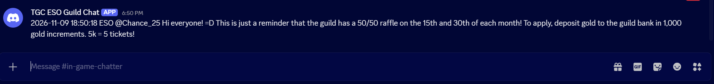
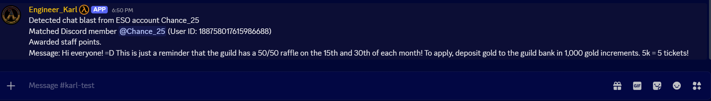
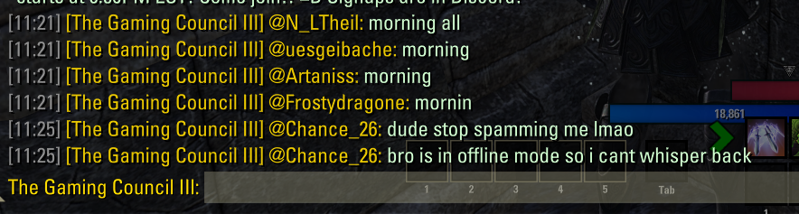
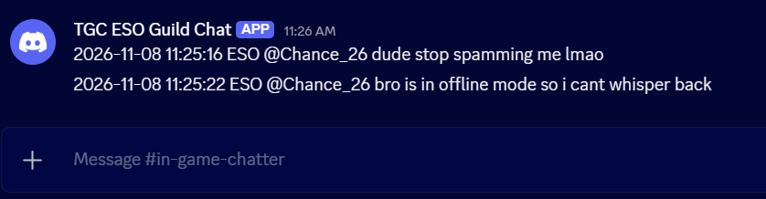
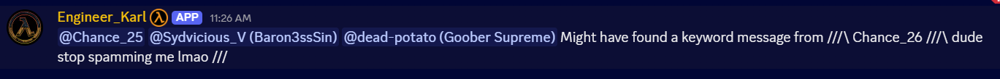

# 2. In-game contests and moderation

## 2A. Contest points

Karl reads the `=D` marker and in-game username in forwarded chat, matches the username to a Discord account, and awards staff points.

**1. Announcement posted in-game**

**2. Announcement forwarded to #in-game-chatter**

**3. Karl matches the member and awards points**

## 2B. In-game chat moderation

Karl reads forwarded in-game messages and alerts staff to suspected abuse.

**1. Message posted in-game**

**2. Message forwarded to #in-game-chatter**

**3. Karl alerts staff**

