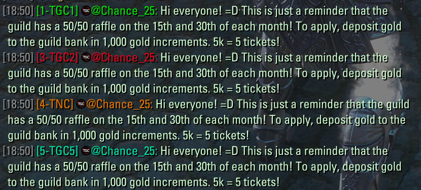

# 2. In-game contests and moderation

## 2A. Contest points

1. A staff member posts a message in-game that would qualify for a staff contest.

### 2. Message Content intent lets Karl read the forwarded message and find the staff member's username so it knows this qualifies for contest points and the user to give it to.

3. Karl matches the account and awards contest points.

## 2B. In-game chat moderation

1. A message is posted in-game.

### 2. Message Content intent lets Karl read forwarded chat to check for abuse.

3. Karl alerts staff to suspected abuse.

