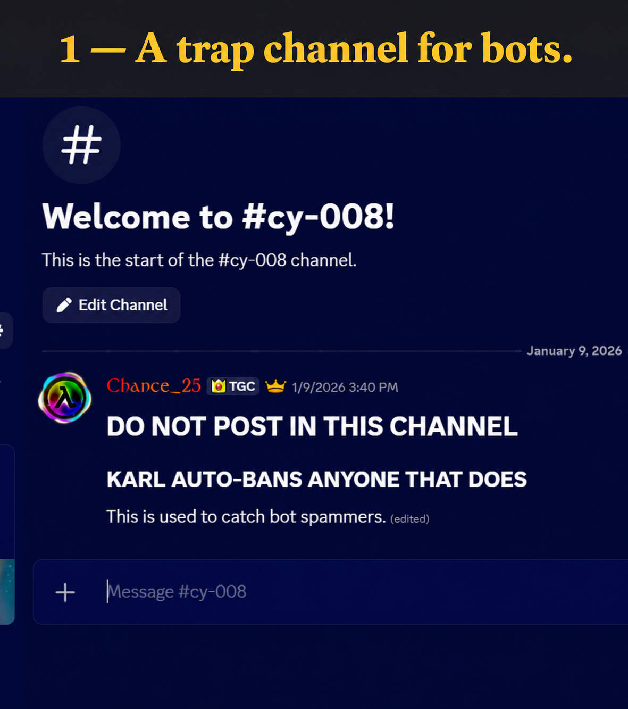
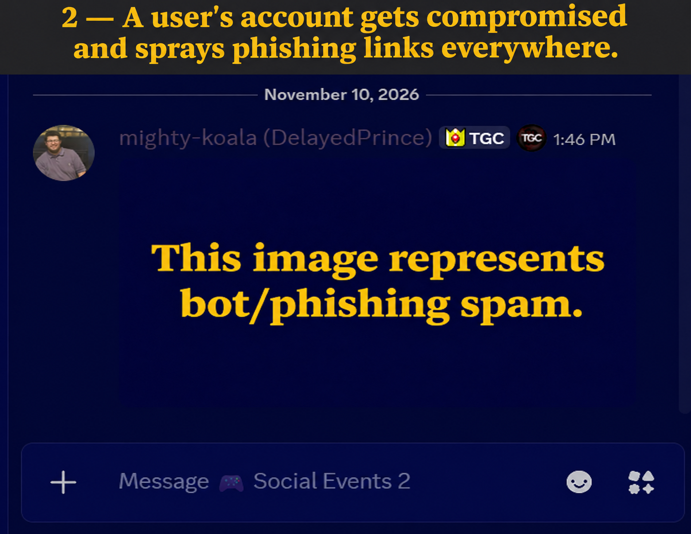
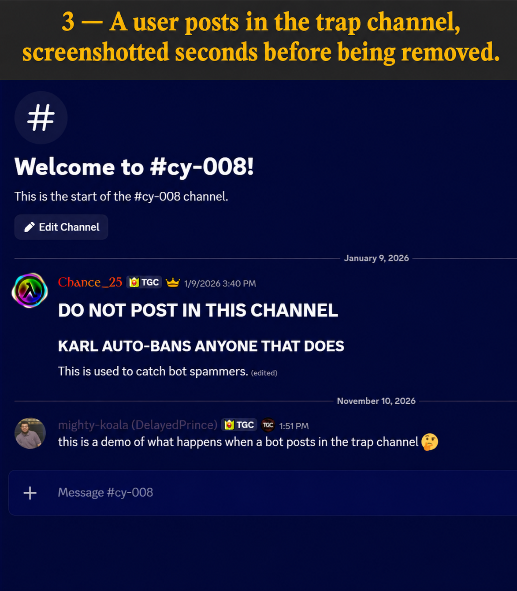
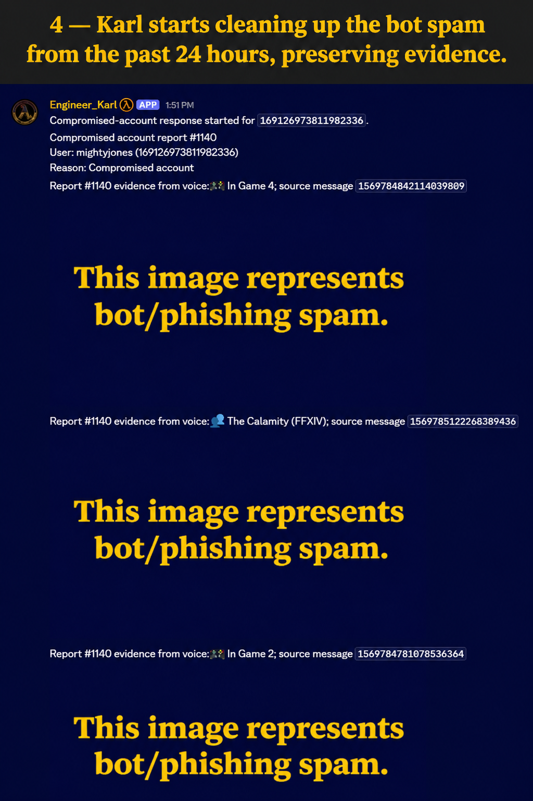
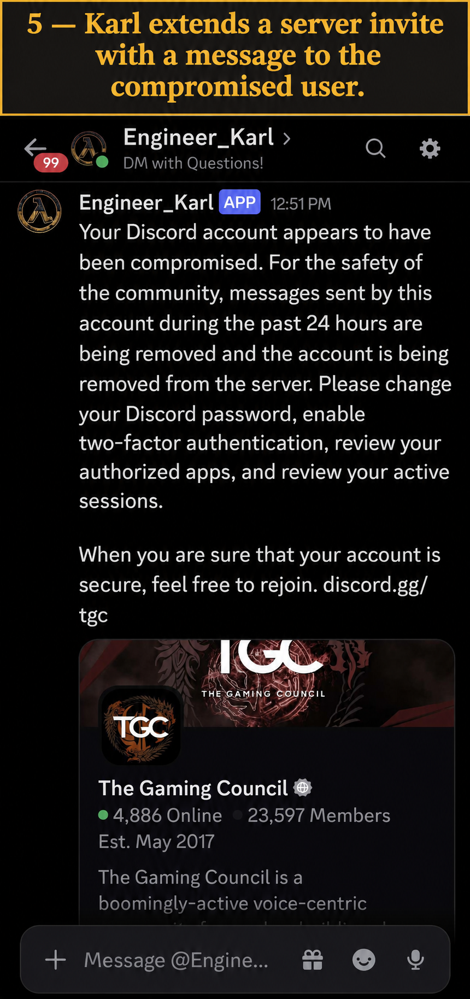
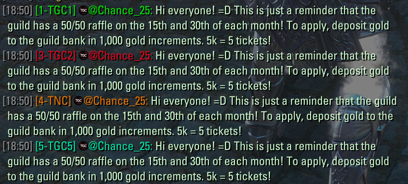
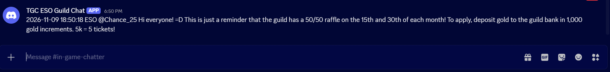
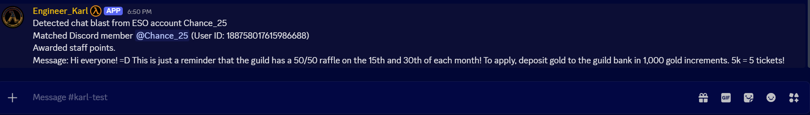
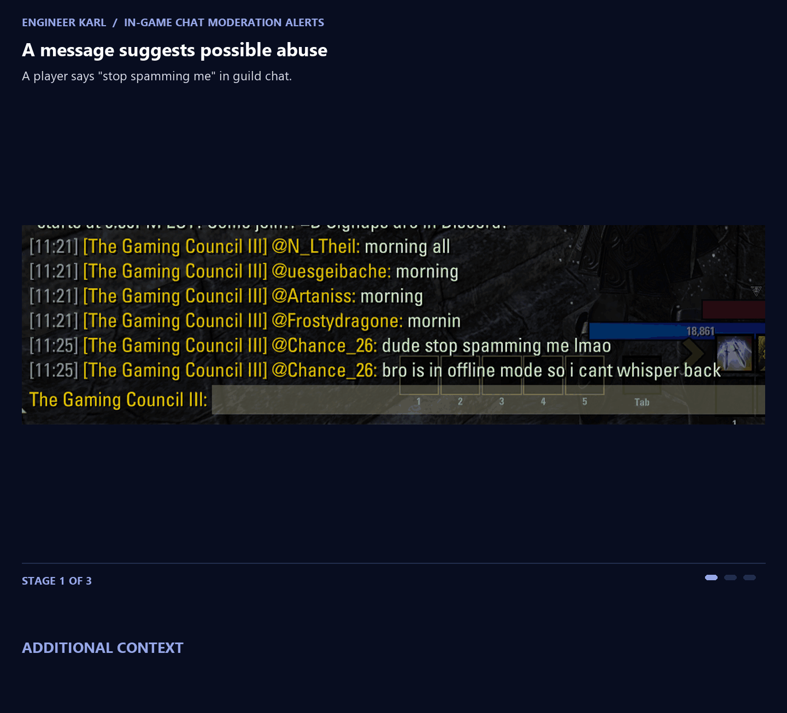

# Message Content — Engineer Karl demos

## 1. Compromised-account response

### Trap channel

### Spam posted by the compromised account

### Trap-channel post before removal

### Spam cleanup and evidence preservation

### Message and server invite

## 2. In-game contests and moderation

### Contest points

Karl reads the `=D` marker and in-game username in forwarded chat, matches the username to a Discord account, and awards staff points.

**1. Announcement posted in-game**

**2. Announcement forwarded to #in-game-chatter**

**3. Karl matches the member and awards points**

### In-game chat moderation

Karl reads forwarded in-game messages and alerts staff to suspected abuse.

